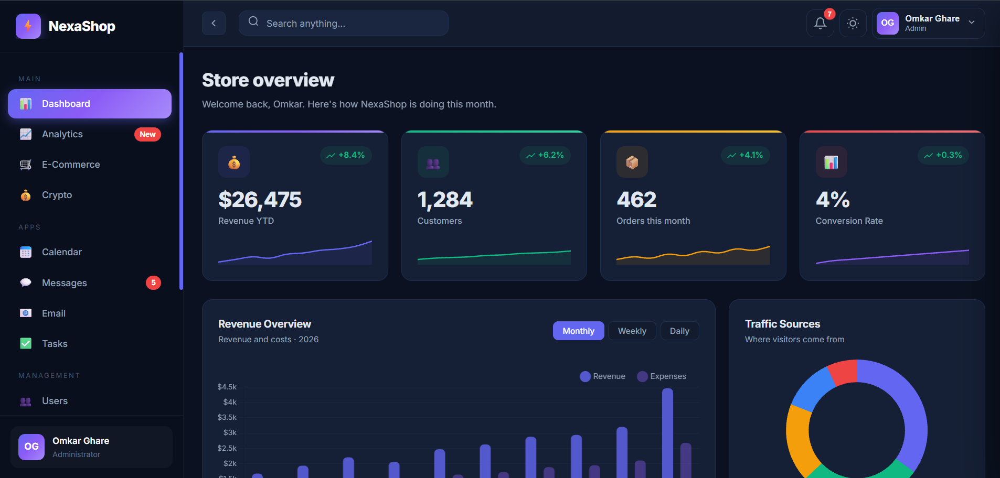

# 📊 Interactive Dashboard — Admin Panel

> A modern, responsive and interactive admin dashboard built using **HTML, CSS and JavaScript**.

An interactive front-end dashboard designed to present business metrics, analytics, transactions and useful admin tools through a clean interface. The project focuses on dashboard UI design, data visualization, theme switching and interactive components.

---

## 🌐 Live Demo

🚀 **Live Demo:** https://ghareomkarr88.github.io/interactive-admin-dashboard/

---

## 📸 Project Preview




---

## ✨ Features

### 📊 Dashboard & Analytics
- Dashboard overview with key performance metrics
- Revenue and business statistics cards
- Analytics and data visualization charts
- Recent activity and dashboard information

### 💳 Transactions & Management
- Recent transaction information
- Order-related dashboard details
- Team member information
- Organized dashboard sections for quick access

### 🧭 Interactive Components
- Sidebar navigation
- Collapsible dashboard sidebar
- Interactive calendar interface
- Notifications and recent activity panel
- Quick-action elements
- Interactive UI controls

### 🎨 UI & Design
- Modern admin dashboard interface
- Responsive dashboard layout
- Light and dark theme support
- Smooth transitions and hover effects
- Dashboard cards and organized content sections
- Modern typography and icons

### 🌙 Theme Preferences
- Switch between light and dark themes
- Improve viewing comfort in different lighting conditions

---

## 🧑‍💻 Tech Stack

| Technology | Usage |
|---|---|
| **HTML5** | Dashboard structure and content |
| **CSS3** | Styling, layouts, responsive design and visual effects |
| **JavaScript** | UI interactions and dashboard behavior |
| **Chart.js** | Data visualization and analytics charts, if included in the project |
| **Google Fonts** | Typography, if loaded by the project |
| **Font Awesome** | Icons, if loaded by the project |

---

## 📁 Project Structure

```text
Interactive-Dashboard/
│
├── index.html
│
├── css/
│   └── style.css
│
├── js/
│   └── script.js
│
├── images/
│   └── dashboard-preview.png
│
└── README.md
```

---

## 🚀 Getting Started

### 1. Clone the Repository

```bash
git clone https://github.com/ghareomkarr88/interactive-admin-dashboard.git
```

### 2. Navigate to the Project

```bash
cd interactive-admin-dashboard
```

### 3. Run the Project

Open `index.html` directly in your browser, or use **Visual Studio Code with the Live Server extension** for local development.

No build process is required for a basic static HTML, CSS and JavaScript project unless you add additional tooling.

---

## 💡 Key Functionality

### Analytics & Metrics
The dashboard presents business and performance information through metric cards and visual analytics components.

### Data Visualization
Charts help present dashboard information in a visual format. If Chart.js is used, its chart components are rendered through the library.

### Sidebar Navigation
The sidebar organizes dashboard sections and provides a navigation area for accessing different parts of the interface.

### Transactions & Activity
Transaction details and recent activity sections help demonstrate how an admin panel can organize operational information.

### Calendar & Notifications
The calendar and notification interface provide additional dashboard tools in one place.

### Theme Switching
Users can switch between **Light Mode** and **Dark Mode** for different viewing preferences.

---

## 📱 Responsive Design

The dashboard is intended to adapt to common screen sizes, including:

- 🖥️ Desktop
- 💻 Laptop
- 📱 Mobile
- 📟 Tablet

The navigation, charts, cards and dashboard sections should adapt to different screen sizes for a consistent user experience.

---

## 🎯 Project Goals

This project was developed to practice and demonstrate:

- Front-end web development
- Dashboard UI/UX design
- Responsive layout development
- HTML structure and CSS styling
- JavaScript event handling and DOM manipulation
- Data visualization
- Interactive components and navigation
- Theme switching
- Organizing business metrics and dashboard content

---

## 🔮 Future Improvements

- [ ] Backend API integration
- [ ] Real-time analytics and dynamic data
- [ ] User authentication and role-based access
- [ ] Advanced search, sorting and filtering
- [ ] Export reports in CSV or PDF format
- [ ] Real-time notifications
- [ ] Pagination for larger data sets
- [ ] Improved accessibility and keyboard navigation
- [ ] Separate HTML, CSS and JavaScript files
- [ ] Automated testing and error handling

---

## ⚠️ Disclaimer

This project is a **front-end demonstration project** created for learning and portfolio purposes.

Dashboard figures, charts and transaction information should be treated as sample data unless the project is connected to a real data source.

The interface does not provide real authentication, backend services or live business data unless those features are implemented separately.

---

## 📚 Learning Highlights

```text
HTML5
   ↓
Dashboard Structure
   ↓
CSS3
   ↓
Responsive UI + Visual Styling
   ↓
JavaScript
   ↓
DOM Manipulation + Event Handling
   ↓
Interactive Dashboard Components
   ↓
Analytics + Data Visualization
   ↓
Admin Dashboard Experience
```

---

## 👨‍💻 Author

**Omkar R. Ghare**

Frontend Developer | Web Development Enthusiast

### Connect With Me

- 💻 GitHub: [@ghareomkarr88](https://github.com/ghareomkarr88)
- 📸 Instagram: [@ogcoderworld](https://instagram.com/ogcoderworld)
- ▶️ YouTube: [@ghareomkarr88](https://youtube.com/@ghareomkarr88)
- 📌 Pinterest: [@ghareomkarr88](https://in.pinterest.com/ghareomkarr88/)

---

## ⭐ Show Your Support

If you find this project interesting or useful, consider giving the repository a ⭐ on GitHub!

---

## 📄 License

This project is available for educational and portfolio purposes.

If you want to allow others to reuse, modify or distribute your code, consider adding an appropriate open-source license file.
